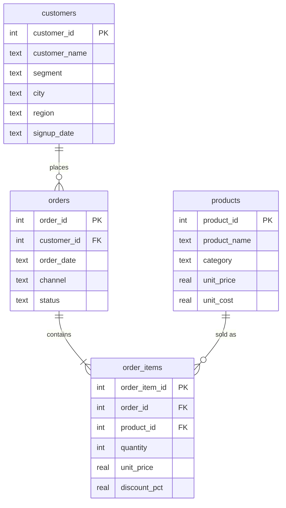

# SQL Sales Analytics

27 business questions answered in SQL, from simple monthly totals to RFM segmentation, cohort retention and market basket analysis. Includes the schema, sample data and the result of every query.


---

## The Problem

Sales data sits in a database, but the questions come from the business: *Which customers are slipping away? Do our discounts pay off? Which products sell together?* Answering them takes more than `SELECT *`: it needs joins, CTEs, window functions and careful date logic.

## The Solution

A small retail database and a library of documented queries. Every query starts with the business question it answers, and its output is saved in the [`results`](results) folder so you can read the answer without running anything.

## The Data

Four tables, 18 months of orders (January 2025 to June 2026). All names are made up.



| Table | Rows |
|---|---|
| customers | 300 |
| products | 24 |
| orders | 4,044 |
| order_items | 7,400 |

The view `v_sales` joins all four tables for completed orders and works out revenue, cost and profit per line, so the analysis queries stay short.

## The Queries

| File | Questions | SQL techniques |
|---|---|---|
| [01_sales_overview.sql](queries/01_sales_overview.sql) | Q01-Q06: monthly revenue, category margin, top products, channel mix, return rates | `GROUP BY`, conditional aggregation (pivot), anti-join |
| [02_customer_analysis.sql](queries/02_customer_analysis.sql) | Q07-Q12: top customers, new vs returning, customers at risk, big spenders | CTEs, `NOT EXISTS`, `HAVING` with subquery, date arithmetic |
| [03_window_functions.sql](queries/03_window_functions.sql) | Q13-Q20: year-to-date, month-on-month growth, moving average, rankings, quartiles | `SUM() OVER`, `LAG`, `RANK`, `ROW_NUMBER`, `NTILE`, window frames |
| [04_advanced_analytics.sql](queries/04_advanced_analytics.sql) | Q21-Q27: year-on-year, RFM segments, cohort retention, Pareto, market basket, discount impact | Self-joins, multi-step CTEs, window functions over aggregates |

## Sample Result

**Q23: RFM segmentation.** Customers are scored 1 to 5 on recency, frequency and monetary value, then grouped:

| rfm_segment | customers | avg_recency_days | avg_orders | revenue | revenue_share_pct |
|---|---|---|---|---|---|
| 1. Champions | 56 | 9 | 28.6 | 113,355,718 | 48.4 |
| 2. Loyal | 29 | 31 | 20 | 39,619,200 | 16.9 |
| 3. New / promising | 27 | 14 | 4.4 | 5,769,248 | 2.5 |
| 4. At risk | 41 | 89 | 12.9 | 35,553,970 | 15.2 |
| 5. Needs attention | 74 | 35 | 7.5 | 25,163,060 | 10.7 |
| 6. Lost | 69 | 114 | 4.2 | 14,818,300 | 6.3 |

**What it says:** 56 "Champions" (19% of customers) bring in almost half the revenue, while 41 "At risk" customers who used to buy often are worth 15% and deserve a win-back campaign.

A few other findings from the sample data:

- **Discounts cost margin without lifting volume** (Q27): margin falls from 23% to 10% at a 15% discount, while average quantity barely moves
- **The festive season matters** (Q01): November revenue is about 50% above a typical month
- **39% of customers bring in 80% of revenue** (Q25)

## How to Use

Only Python is needed (standard library, nothing to install):

```bash
python run_queries.py
```

This builds `sales.db` from `schema.sql` and the CSV files, runs all 27 queries and rewrites the `results` folder. To print one result in the terminal:

```bash
python run_queries.py --show 14
```

You can also open `sales.db` in [DB Browser for SQLite](https://sqlitebrowser.org/) or any SQL client and run the queries by hand.

**Using another database?** The queries are written for SQLite. For SQL Server or PostgreSQL the main changes are the date functions (`strftime`, `julianday`) and `LIMIT`.

## Project Structure

```
sql-sales-analytics/
├── schema.sql              # tables, indexes and the v_sales view
├── queries/                # 27 documented queries in 4 files
├── results/                # the output of every query, as Markdown tables
├── data/
│   ├── *.csv               # sample data
│   └── generate_data.py    # recreates the sample data (fixed seed)
├── run_queries.py          # builds the database and runs everything
├── README.md
└── LICENSE
```

## Roadmap

- [ ] SQL Server (T-SQL) version of the queries
- [ ] Data quality checks (duplicates, orphan rows, outliers)
- [ ] Power BI report on top of the same database

---

**Author:** [Swaminathan Narayanan](https://www.linkedin.com/in/swaminathan-narayanan-9781a7154/): Data Analytics | Excel & VBA Automation | Python | SQL | Power BI
